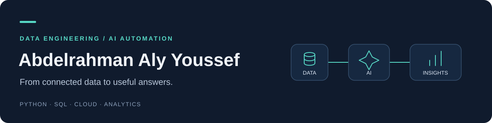

### Hi, I'm Abdelrahman 👋

**Data engineer, analytics team lead, and automation builder based in Egypt.** I connect data sources, build analytical workflows, and develop AI tools that help people find and understand information.

- **Now:** Team Lead — Data & Analytics Product Engineering and QA at **VOIS**.
- **Background:** 4+ years across data engineering, analytics, and Python automation, including roles at **Teleperformance, Majorel, and POSCX**.
- **Building:** AI analytics prototypes, KPI knowledge workflows, and metadata-driven warehouse tools.
- **Interested in:** Data engineering, analytics engineering, and AI automation roles and freelance projects.

## Selected work

### 01 · BigPilot

> **Ask a question. Explore the data.**

An AI analyst that inspects BigQuery schemas, runs analytical SQL, and explains results with charts. A working cloud proof of concept.

**Stack:** `Python` · `Gemini / Vertex AI` · `BigQuery` · `Streamlit` · `Cloud Run`

### 02 · KPI Knowledge & Automation

> **Document KPIs. Make knowledge discoverable.**

SAC dashboard metadata extraction and documentation, paired with a conversational agent for KPI definitions and where-used questions. Internal tooling and agent pilot.

**Stack:** `Node.js` · `Playwright` · `SAP Analytics Cloud` · `Copilot Studio` · `SharePoint`

### 03 · Warehouse Automation

> **Turn recurring setup into reusable workflows.**

Metadata-driven Python utilities for schema inspection, column reconciliation, staging procedures, and dimension and fact-load SQL generation.

**Stack:** `Python` · `SQL Server` · `T-SQL` · `SQLAlchemy`

### 04 · Steam Reviews Data Platform

> **From raw reviews to analytical queries.**

A self-selected training project using a **2.4M-review development sample**, PySpark processing, S3 storage, and a dimensional Redshift warehouse.

**Stack:** `AWS S3` · `EMR` · `PySpark` · `Parquet` · `Redshift`

[Explore the code →](https://github.com/abdelrahmanaly01/steam_reviews_data_warehouse)

**More project discussions:** [Visit my Upwork profile](https://www.upwork.com/freelancers/~0174b6b4ea071d6022) or [get in touch](mailto:abdelrahman.aly.yossef@gmail.com).

## Where I can help

**Data pipelines & warehouses** — ETL/ELT, database and API integration, dimensional modeling, and metadata-driven SQL generation.

**Python automation** — Data preparation, reconciliation, reporting workflows, and Excel/CSV exports.

**AI & analytics** — Natural-language-to-SQL prototypes, KPI documentation and knowledge agents, plus BI interaction, performance, and validation work.

## Tools I work with

| Focus | Toolkit |
| --- | --- |
| Engineering | **Python · SQL** · pandas · SQLAlchemy · Git · Linux |
| Data & cloud | Azure Data Factory · Databricks · Azure SQL · SQL Server · PostgreSQL · BigQuery · AWS S3 · EMR · Redshift |
| AI & automation | Gemini / Vertex AI · Copilot Studio · Node.js · Playwright · REST APIs · Docker · Cloud Run |
| Analytics | SAP Analytics Cloud · Power BI · Plotly · Streamlit · SharePoint · Power Automate |

## Career journey

### VOIS · Team Lead — Data & Analytics Product Engineering and QA
**Nov 2025–Present**

Lead a cross-functional engineering and QA team. Work spans agentic analytics, KPI documentation automation, and enhancements to a production SAP Analytics Cloud product, including interactions, analytical views, performance, and validation.

### Teleperformance · Data Engineer I
**Nov 2024–Oct 2025**

Developed metadata-driven warehouse automation and worked on Azure Data Factory / Databricks pipelines, Python ETL, Azure Functions, Automation Runbooks, and Azure SQL Database.

### Majorel · Global Data Engineer
**Apr 2024–Nov 2024**

Built warehouse and pipeline workflows with Azure Data Factory and Azure SQL, and automated integrations using Python, cloud functions, and APIs.

### POSCX · Data Analyst
**May 2022–Apr 2024**

Led analytics work, built a historical-leads warehouse, delivered Power BI dashboards, and automated reporting and data preparation with PostgreSQL, Python, and Excel.

## Education & credentials

- **Microsoft Fabric Data Engineer Associate** — earned August 2025.
- **Microsoft Azure Data Scientist Associate** — earned March 2023.
- **[DataCamp Professional Data Analyst](https://www.datacamp.com/certificate/DA0015611246474)**.
- **ITI — Data Analysis and Visualization**, 2021–2022.
- **Bachelor's degree in Management Information Systems**, Faculty of Commerce, Alexandria University, 2017–2021.

---

### Have a data problem worth solving?

Tell me what you need to connect, automate, or understand—and what a successful outcome would look like.

**[Let's connect on LinkedIn](https://www.linkedin.com/in/abdelrahman-a-youssef/)** · **[Discuss a project on Upwork](https://www.upwork.com/freelancers/~0174b6b4ea071d6022)** · **[Email me](mailto:abdelrahman.aly.yossef@gmail.com)**
